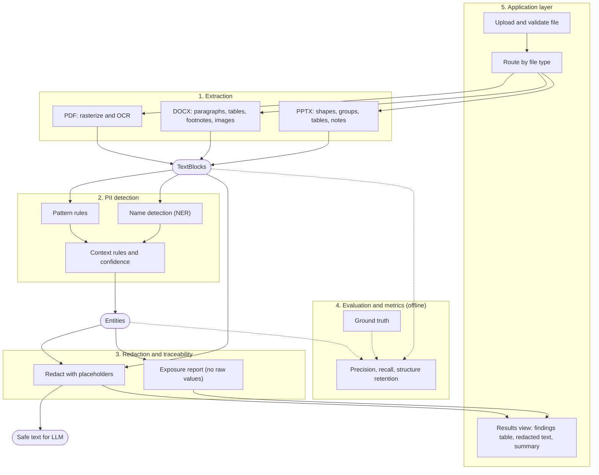

# PII Redaction Pipeline

A pipeline that extracts text from scanned PDFs, Word and PowerPoint files, detects and classifies
personally identifiable information (PII), and redacts it before documents reach an LLM.

Built for the Optiv Consulting case study "Text Analysis and PII Detection" (client scenario: Cadence,
a financial services firm whose policy forbids PII from being processed by AI models).

> **Confidential:** the sample files are case material. They never go in this repo. Share them only via the
> private team Drive folder: <link>

---

## 1. What we are building

**File in, then extract, detect, redact, report.** The system must:
- Extract text from each file type, keeping at least 80% of the original structure and context
- Detect and classify PII (employee IDs, full names, contact details, government IDs), with coverage approaching 100% and minimal false positives
- Redact PII before any LLM processing, with source traceability (which file, where)
- Run as a live demo: upload files, extract text, show the PII found in each file

The brief does not define how "80% structure" or "100% coverage" are measured. We define them ourselves
and state the definitions in the deck.

## 2. Architecture



Solid arrows are the runtime pipeline. Dotted arrows are offline evaluation against hand-labelled ground truth.

### The data contract

Everything passes through three types, defined in `src/pii_pipeline/schemas.py`:

| Type | Produced by | Meaning |
|---|---|---|
| `TextBlock` | Extraction | One chunk of text with its file, location and reading-order index |
| `Entity` | Detection | One PII finding, with offsets inside a block's text, type, confidence and detector |
| `RedactedBlock` | Redaction | A block's text with PII replaced by placeholders like `[EMAIL_1]` |

Rules of the contract:
- `Entity.start` and `Entity.end` count characters from the start of that block's text; `end` is exclusive (like `text[start:end]`).
- `Entity.value` is the raw PII. **Never print, log or report it.** Use `Entity.public_info()` for anything shown.
- Don't change `schemas.py` without telling the team first (open an issue). Everyone depends on it.

## 3. Roles and branches

| Role | Branch | Folder | Owner |
|---|---|---|---|
| Extraction | `extraction` | `src/pii_pipeline/extraction/` | <name> |
| PII detection | `detection` | `src/pii_pipeline/detection/` | <name> |
| Redaction and traceability | `redaction` | `src/pii_pipeline/redaction/` | <name> |
| Evaluation and metrics | `evaluation` | `src/pii_pipeline/evaluation/` | <name> |
| Application layer (also assists extraction) | `application` | `src/pii_pipeline/app/`, `notebooks/` | <name> |

**Edit only your own folder.** If you need a change in someone else's, ask them or open an issue.

**Branch rules:**
- Each person works **only on their own role's branch**. Never commit to another role's branch.
- Don't create extra branches without agreeing it with <repo manager>.
- Your work reaches `main` only through a pull request from your branch.
- Need something from another role? Ask them or open an issue. Don't edit their folder or branch yourself.

## 4. Guidelines per role

### Extraction
Turn each file into a list of `TextBlock`s in reading order.
- **Scanned PDF:** every page is an image with no text layer, so OCR is required. Record `ocr_confidence`.
- **DOCX:** keep paragraphs and tables in order; include footnotes and text inside images.
- **PPTX:** text hides in grouped shapes and tables; sort by position for reading order.
- **Done when:** all three sample files produce `TextBlock`s and you've hand-checked that tables, footnotes and image text are present.

### PII detection
Take `TextBlock`s and return `Entity`s.
- Combine pattern rules (IDs, emails, phones), a name detector (NER), and context rules to remove false positives.
- Use local models only. Raw text must never be sent to an external API.
- Prioritise recall (a miss is a leak), then reduce false positives without losing real PII.
- **Done when:** the PII types named in the brief are detected, with precision and recall measured by evaluation.

### Redaction and traceability
Take blocks and entities and return `RedactedBlock`s plus a report.
- The same value gets the same placeholder within a file (`[PERSON_1]`).
- Handle overlapping entities and keep offsets correct.
- The report lists type, location and confidence, **never the raw value**.
- **Done when:** redacted text contains no detected PII and every finding traces back to a file and location.

### Evaluation and metrics
Prove the numbers for the "Reliable outcomes" slide.
- Hand-label PII in the sample files (ground truth), ideally two people independently. Keep it out of git.
- Compute precision and recall per file and per PII type; define how partial matches count.
- Define the structure-retention metric and record the definition in `docs/`.
- **Done when:** one command prints precision, recall and structure retention for each file.

### Application layer
Wire the pipeline together and build the demo.
- Chain extraction, detection and redaction behind one function; handle unsupported or empty files.
- Build the upload-and-results demo (Colab or a small UI). Keep notebooks thin: logic lives in `src/`.
- Early on, help the extraction role with the shared OCR helper and PDF preprocessing.
- **Done when:** a fresh Colab runs the demo on all three sample files without manual fixes.

## 5. Working with Git

Setup, once (Python 3.12 for everyone, so we all match):
```
git clone <repo-url>
cd pii-redaction-pipeline
git checkout <your-branch>
```

Every work session:
```
git fetch origin
git merge origin/main          # bring in others' merged work
# ... edit files in YOUR folder ...
git add .
git status                     # check: no sample files, no raw PII
git commit -m "module: what you changed"
git push origin <your-branch>
```

After checking out, run `git branch` to confirm the `*` is next to your branch.

When something works, open a **pull request** from your branch into `main` and fill in the template.
<repo manager> reviews and merges. Small, frequent PRs beat one big PR at the end.


## 6. Rules

1. **Never push directly to `main`.** Always use a pull request. (GitHub can't enforce this on our plan, so we enforce it ourselves.)
2. **No sample files, ground truth or real PII in git.** Not even as screenshots or extracted text.
3. **No raw PII in prints, logs or reports.** Use `Entity.public_info()`.
4. **No external APIs for detection or OCR.** Everything runs locally.
5. **Edit only your own folder.** Don't change `schemas.py` without agreement.
6. Merge `origin/main` into your branch at least once a day.
7. If you use an AI assistant, never paste sample content or extracted text into it; use fake text.
8. Commit only to your own role's branch. Check with `git branch` before you commit that it shows the branch you expect.


> **Confidential:** the sample files are case material. They never go in this repo. Share them only via the
> private team Drive folder: <link>

